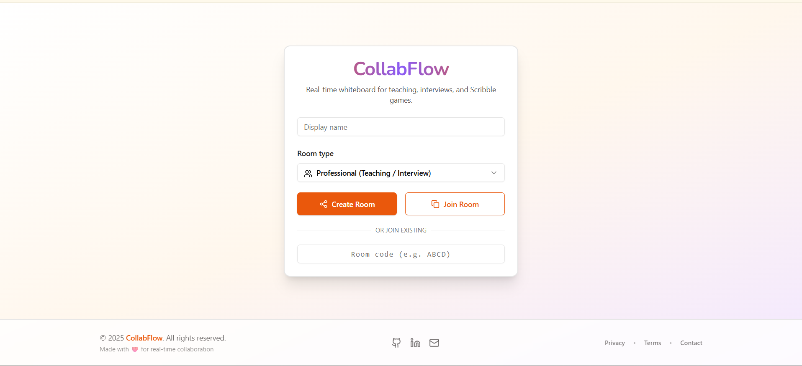
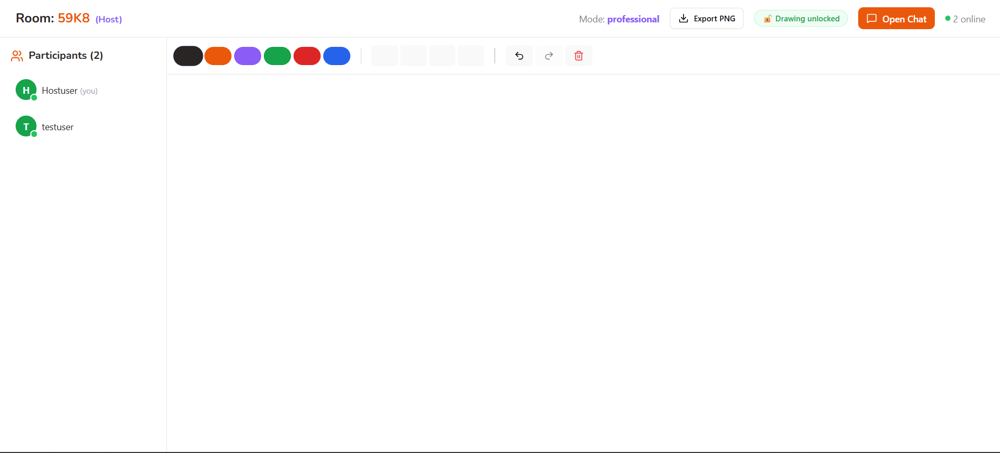
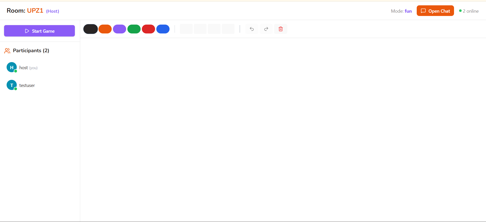

# CollabFlow

[](YOUR_NEW_VERCEL_URL)
[](LICENSE)

A real-time collaborative whiteboard with a built-in drawing game. Suited to teaching, interviews, brainstorming and casual multiplayer play.

## Features

### Professional Mode

- **Real-time drawing:** multiple people draw on the same canvas
- **Live cursors:** see where others are working
- **Host controls:** lock or unlock drawing for participants
- **Undo / redo:** synced across the room
- **Export:** save the canvas as a PNG
- **Built-in chat:** talk while you draw

### Fun Mode

- **Draw and guess:** Pictionary-style gameplay
- **Automatic drawer rotation:** everyone gets a turn
- **60-second rounds:** race against the clock
- **Scoring:** faster guesses earn more points
- **Automatic round management:** rounds start and end on their own

## Live Demo

[YOUR_NEW_VERCEL_URL](YOUR_NEW_VERCEL_URL)

## Tech Stack

| Layer      | Technology                                   |
| ---------- | -------------------------------------------- |
| Frontend   | React, Vite, Tailwind CSS, shadcn/ui, Socket.IO Client |
| Backend    | Node.js, Express, Socket.IO                  |
| Deployment | Vercel (client), Render (server)             |

## Installation

**Prerequisites:** Node.js 20 or later and npm.

```bash
git clone YOUR_NEW_REPO_URL
cd CollabFlow

# Server
cd server
npm install
cp .env.example .env
npm run dev

# Client (in a second terminal)
cd client
npm install
npm run dev
```

Open `http://localhost:5173` to see the app running locally.

## Usage

### Create a room

1. Enter your display name.
2. Choose a room type (Professional or Fun).
3. Select **Create Room**.
4. Share the room code with others.

### Join a room

1. Enter your display name.
2. Enter the room code.
3. Select **Join Room**.

### Professional Mode

- Draw freely on the shared canvas.
- The host can lock or unlock drawing for participants.
- Export the canvas as a PNG.
- Chat with participants in real time.

### Fun Mode

- The host starts the game.
- One person draws while the others guess.
- Type guesses into the chat.
- Correct guesses earn points.
- The drawer rotates each round.

## Screenshots

### Home Page



### Professional Mode



### Fun Mode




## Author

**Nandani Singh**

- GitHub: [@YOUR_NEW_USERNAME](https://github.com/NandaniSigh27)

## License

Released under the [MIT License](LICENSE).